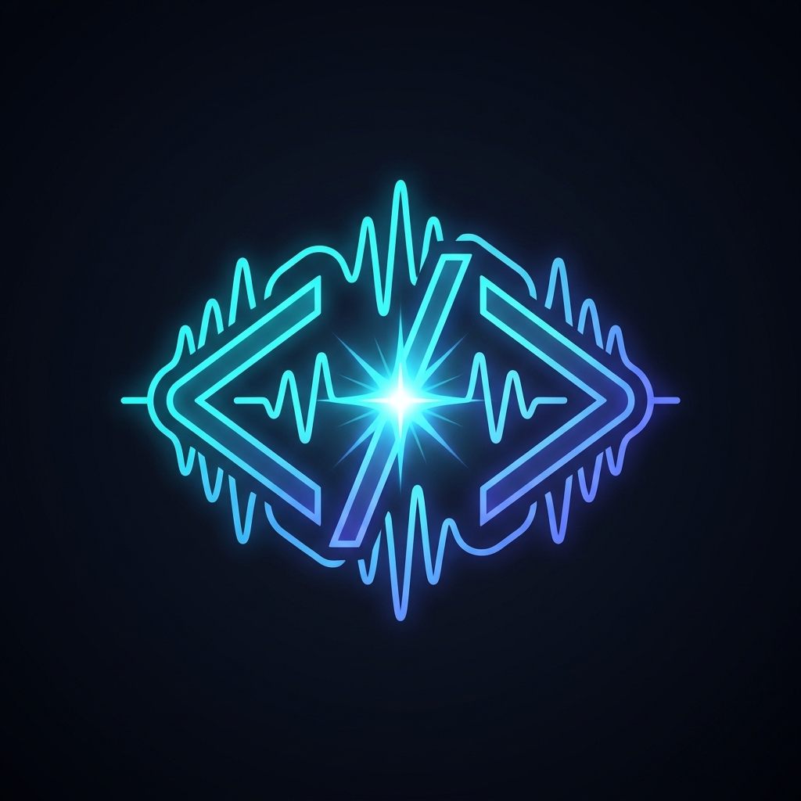
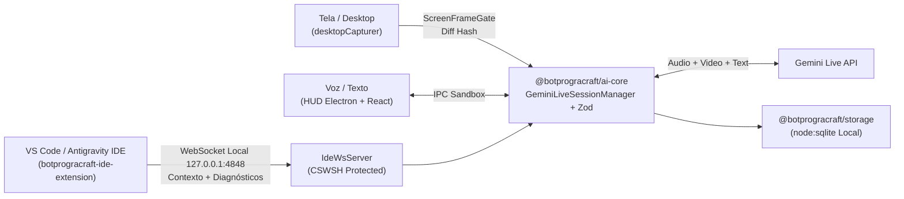

<p align="center">
  
</p>

<h1 align="center">BotPrograCraft</h1>

<p align="center">
  <strong>Tutor de Programação & Lógica ao Vivo com Voz Bidirecional, Leitura de Tela Inteligente e Ponte para VS Code / Antigravity IDE.</strong>
</p>

<p align="center">
  
  
  
  
  
  
</p>

<p align="center">
  <a href="https://github.com/Henrique1601/BotPrograCraft/releases/latest">🚀 Download (.zip / .exe)</a> •
  <a href="https://github.com/Henrique1601/BotPrograCraft/releases/latest">🔌 Extensão IDE (.vsix)</a> •
  <a href="#-primeiros-passos">⚡ Primeiros Passos</a> •
  <a href="./docs/PRD.md">📚 Documentação & ADRs</a> •
  <a href="./CHANGELOG.md">📦 Changelog</a>
</p>

---

## O Que É & Problema que Resolve

Estudar lógica de programação ou programar em projetos reais muitas vezes exige alternar entre o editor, o navegador com enunciados de exercícios e chats de IA que não enxergam o que está na sua tela nem os erros do seu editor.

O **BotPrograCraft** resolve isso combinando:
- **Ponte direta com VS Code e Antigravity IDE** (`ws://127.0.0.1:4848`): envia em tempo real arquivo ativo, seleção e diagnósticos (erros/warnings) — com redação automática de arquivos sensíveis (`.env`, `*.pem`, `*.key`).
- **HUD Flutuante Always-On-Top (Electron + React):** voz ao vivo bidirecional via **Gemini Live API** (microfone PCM16 16kHz + áudio de resposta 24kHz), texto, modo compacto em pílula e aba de **Progresso** persistida em SQLite local.
- **Leitura de Tela Inteligente (*Smart Frames*):** envia frames apenas quando há mudança real na tela (`ScreenFrameGate`), economizando tokens e latência.
- **5 Modos de Tutoria:** `socratic`, `pair-programming`, `explain-bug`, `logic-challenge` e `direct` (**Direto / Sem Filtro** — respostas completas e imediatas, com `BLOCK_NONE` quando habilitado).

---

## Arquitetura



### Pacotes do Monorepo
| Pacote | Função |
|---|---|
| `packages/shared` (`@botprogracraft/shared`) | Contratos TypeScript (`TutorMode`, `IdeContextPayload`, `WsMessage`, `ScreenFrame`, `LiveSessionConfig`). |
| `packages/ai-core` (`@botprogracraft/ai-core`) | Cliente Gemini Live API, prompts dos 5 modos, `ContextAggregator`, `ScreenFrameGate` e schemas Zod (**TypeSafe AI**). |
| `packages/storage` (`@botprogracraft/storage`) | Persistência local em `node:sqlite` (Node 24+) para tentativas, erros recorrentes e histórico. |
| `packages/desktop-app` (`@botprogracraft/desktop-app`) | HUD Electron + React (áudio bidirecional, captura de tela, servidor WS local e painel de Progresso). |
| `packages/ide-extension` (`botprogracraft-ide-extension`) | Extensão compatível com VS Code e Antigravity IDE. |

---

## 🚀 Download & Instalação (Usuário Final)

1. Baixe os artefatos na página de **[Releases](https://github.com/Henrique1601/BotPrograCraft/releases/latest)**:
   - `BotPrograCraft-vX.Y.Z-win-x64.zip` → extraia e execute `BotPrograCraft.exe`.
   - `botprogracraft-ide-extension-X.Y.Z.vsix` → no VS Code ou Antigravity IDE, abra *Extensions* (`Ctrl+Shift+X`) → `...` → **Install from VSIX...**.
2. Crie um arquivo `.env` na pasta do app (ou workspace) com sua chave `GEMINI_API_KEY`.

---

## ⚡ Primeiros Passos (Desenvolvedores)

### Pré-requisitos
- **Node.js 24+** (utiliza `node:sqlite` nativo) e **npm 10+**

### Setup Local
```bash
git clone https://github.com/Henrique1601/BotPrograCraft.git
cd BotPrograCraft
npm install
cp .env.example .env
```

Preencha sua chave no `.env` e execute:
```bash
npm run build
npm run typecheck
npm test
```

Para rodar em modo desenvolvimento no VS Code / Antigravity IDE, pressione **`F5`** selecionando **`Launch BotPrograCraft (Extension + Desktop App)`**.

---

## Variáveis de Ambiente (`.env.example`)

| Variável | Obrigatória | Descrição |
|---|---|---|
| `GEMINI_API_KEY` | Sim | Chave da API Gemini para sessões ao vivo (`GeminiLiveSessionManager`). |
| `BOTPROGRACRAFT_WS_PORT` | Não | Porta do servidor WebSocket local (padrão: `4848`). |

---

## Contribuição & Licença

- Padrão de commits: **Conventional Commits** (`feat:`, `fix:`, `refactor:`, `docs:`, `test:`, `chore:`).
- Documentação arquitetural: [docs/PRD.md](./docs/PRD.md) e [docs/decisions/](./docs/decisions/).
- Licenciado sob a [MIT License](./LICENSE) © 2026 Henrique Bezerra Dos Santos.
