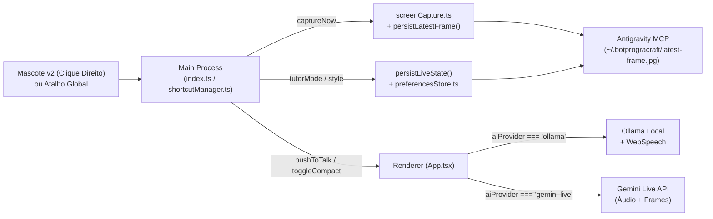
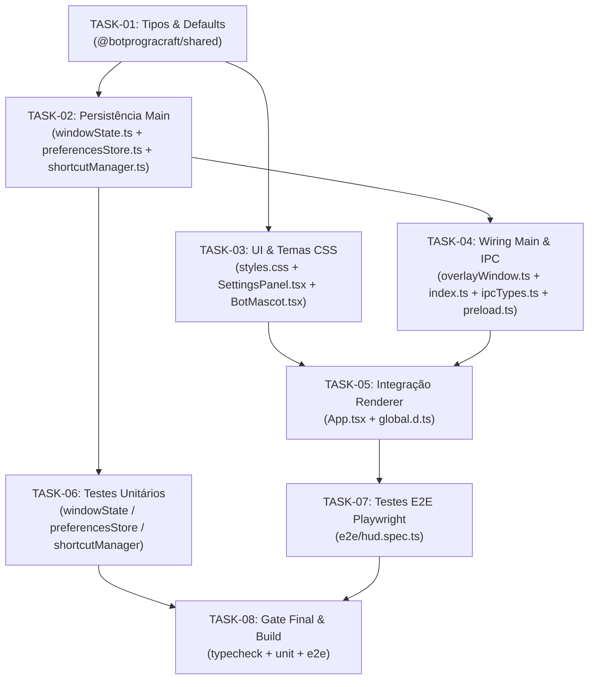

# Roadmap v0.6.0 — Mascote v2, Preferências, Temas & Paridade Multi-IA

**Status:** Planejado (`planning-master-agent`)  
**Escopo:** Exclusivamente `v0.6.0` (Desktop App HUD/Main + Shared Types)  
**Princípio de Arquitetura:** Zero overengineering, persistência atômica em `~/.botprogracraft/` (respeitando `BOTPROGRACRAFT_HOME`), paridade total entre **Antigravity MCP**, **Ollama Local** e **Gemini Live API**.

---

## 1. Visão Executiva & Escopo Aprovado

A versão `v0.6.0` transforma o overlay flutuante do BotPrograCraft em um companheiro de desktop persistente, personalizável e acessível via atalhos globais, mantendo funcionamento idêntico independentemente do provedor de IA ativo:

1. **Mascote v2**
   - Persistência da posição `(x, y)` da janela do overlay/mascote em `~/.botprogracraft/window-state.json` com validação contra os monitores conectados (`screen.getDisplayMatching` / `screen.getAllDisplays`) e fallback seguro para o monitor primário.
   - Menu de contexto rápido no clique direito do mascote (`Menu.buildFromTemplate` nativo do Electron disparado via IPC, com fallback seguro ou integração limpa com o `setIgnoreMouseEvents`): trocar modo de tutoria (`socratic` | `pair` | `challenge` | `review`), trocar estilo (`robot` | `pixel` | `orb`), capturar tela agora e expandir/recolher HUD.
2. **Atalhos Globais Customizáveis & Auto-Start no Windows**
   - Persistência de preferências em `~/.botprogracraft/preferences.json` (atalhos `pushToTalk`, `toggleCompact`, `captureNow`, além de tema, opacidade, estilo do mascote e auto-start).
   - Registro dinâmico com validação via `globalShortcut.register` e **rollback automático** para o atalho anterior caso o novo atalho falhe ou conflite com o SO.
   - Toggle de Auto-Start no Windows via `app.setLoginItemSettings({ openAtLogin })` quando empacotado (`app.isPackaged`), com feedback explícito na UI quando executado em modo de desenvolvimento.
3. **Temas & Opacidade do HUD**
   - Seletor de tema (`cyan` | `emerald` | `cyberpunk`) via CSS custom properties (`data-hud-theme` no root do HUD).
   - Controle deslizante de opacidade (`0.55` a `1.0`) aplicado ao HUD expandido (e opcionalmente ao container do mascote via `--hud-opacity`), persistido em `preferences.json`.
4. **Foco de IA Equilibrado (Antigravity MCP + Ollama Local + Gemini Live)**
   - Todas as ações rápidas do Mascote v2 e atalhos globais (`pushToTalk`, `toggleCompact`, `captureNow`, troca de modo) operam sobre o estado unificado do `main` (`persistLiveState()`, `persistLatestFrame()`, `sendToRenderer()`), garantindo paridade entre:
     - **Antigravity MCP** (lê `~/.botprogracraft/live-state.json` e `latest-frame.jpg` atualizados em tempo real);
     - **Ollama Local** (texto/visão + Web Speech API no renderer);
     - **Gemini Live API** (áudio bidirecional + frames em tempo real).

### Fora de Escopo (Non-Goals da v0.6.0)
- Novos provedores de IA além de Antigravity MCP, Ollama e Gemini Live.
- Sincronização de preferências em nuvem ou banco remoto.
- Suporte a auto-start específico para macOS/Linux além do comportamento padrão de `app.setLoginItemSettings` (foco explícito em Windows).
- Animações 3D/WebGL pesadas no mascote.

---

## 2. Arquitetura & Arquivos por Pacote

### 2.1 `@botprogracraft/shared`
| Arquivo | Ação | Responsabilidade |
|---|---|---|
| `packages/shared/src/types.ts` | Editar | Adicionar tipos compartilhados: `MascotStyle` (`'robot' \| 'pixel' \| 'orb'`), `HudTheme` (`'cyan' \| 'emerald' \| 'cyberpunk'`), `ShortcutAction` (`'pushToTalk' \| 'toggleCompact' \| 'captureNow'`), `ShortcutConfig`, `UserPreferences`, `WindowStateBounds`. |
| `packages/shared/src/index.ts` | Editar | Re-exportar novos tipos e constantes padrão (`DEFAULT_USER_PREFERENCES`, `DEFAULT_SHORTCUTS`, `HUD_OPACITY_MIN = 0.55`, `HUD_OPACITY_MAX = 1.0`). |

### 2.2 `@botprogracraft/desktop-app` — Main Process
| Arquivo | Ação | Responsabilidade |
|---|---|---|
| `packages/desktop-app/src/main/windowState.ts` | **Criar** | Leitura/escrita atômica de `~/.botprogracraft/window-state.json` e função pura `clampWindowPositionToDisplays(bounds, displays, primaryWorkArea)` usando `screen.getDisplayMatching` e `screen.getAllDisplays` para garantir visibilidade mínima (ex.: >= 80px dentro do `workArea` de um display ativo). |
| `packages/desktop-app/src/main/preferencesStore.ts` | **Criar** | Leitura/escrita atômica e validação de `~/.botprogracraft/preferences.json` (atalhos, tema, opacidade `0.55..1.0`, `mascotStyle`, `openAtLogin`), com merge seguro contra defaults. |
| `packages/desktop-app/src/main/shortcutManager.ts` | **Criar** | Gerenciador de atalhos globais (`pushToTalk`, `toggleCompact`, `captureNow`) com `registerShortcutWithRollback()` usando `globalShortcut.register` + `unregister` seletivo (sem perder os demais atalhos em caso de falha). |
| `packages/desktop-app/src/main/overlayWindow.ts` | Editar | Aceitar posição inicial opcional `{ x, y }` validada pelo `windowState.ts` em `OverlayWindowOptions`; manter fallback para canto inferior direito do `screen.getPrimaryDisplay().workArea`. |
| `packages/desktop-app/src/main/index.ts` | Editar | Integrar `windowState.ts` (salvar `(x, y)` com debounce em `move`/`moved` e `close`), `preferencesStore.ts`, `shortcutManager.ts`, `app.setLoginItemSettings({ openAtLogin })` (checando `app.isPackaged`), e handler IPC `desktop:show-mascot-context-menu` usando `Menu.buildFromTemplate` (com itens: Modo de Tutoria, Estilo do Mascote, Capturar Tela Agora, Expandir/Recolher HUD). Garantir atualização imediata de `live-state.json` e `latest-frame.jpg` para paridade MCP. |
| `packages/desktop-app/src/main/ipcTypes.ts` | Editar | Incluir `preferences: UserPreferences`, `autoStartSupported: boolean` em `DesktopStateSnapshot`; adicionar métodos em `DesktopBridgeApi`: `getPreferences`, `updatePreferences`, `updateShortcut`, `setAutoStart`, `showMascotContextMenu`, e listeners `onToggleCompact`, `onPreferencesChanged`. |
| `packages/desktop-app/src/main/preload.ts` | Editar | Expor novos canais `ipcRenderer.invoke` e `subscribe` no `contextBridge.exposeInMainWorld('botprogracraft', api)`. |

### 2.3 `@botprogracraft/desktop-app` — Renderer & Styles
| Arquivo | Ação | Responsabilidade |
|---|---|---|
| `packages/desktop-app/src/renderer/global.d.ts` | Editar | Atualizar tipagem global de `window.botprogracraft` caso necessário (re-export de `DesktopBridgeApi`). |
| `packages/desktop-app/src/renderer/components/BotMascot.tsx` | Editar | Adicionar prop `onContextMenu?: (e: React.MouseEvent) => void` (disparando `e.preventDefault()` + menu nativo via IPC) e suporte opcional à opacidade via variável CSS `--hud-opacity`. |
| `packages/desktop-app/src/renderer/components/SettingsPanel.tsx` | **Criar** | Painel/seção enxuta de Configurações no HUD expandido: seletor de Tema (`cyan` \| `emerald` \| `cyberpunk`), slider de Opacidade (`0.55`–`1.0`), editor de Atalhos Globais (`pushToTalk`, `toggleCompact`, `captureNow`) com feedback de erro/rollback, e toggle de Auto-Start no Windows (com aviso claro em modo dev). |
| `packages/desktop-app/src/renderer/App.tsx` | Editar | Sincronizar `mascotStyle`, `hudTheme`, `hudOpacity`, `preferences` a partir do snapshot inicial e `onPreferencesChanged`; aplicar `data-hud-theme` e `--hud-opacity` no container raiz; conectar `onToggleCompact` (atalho global e menu de contexto) e `onContextMenu` do `BotMascot`; garantir que `captureNow` e `pushToTalk` funcionem de forma idêntica para MCP, Ollama e Gemini Live. |
| `packages/desktop-app/src/renderer/styles.css` | Editar | Definir paletas `[data-hud-theme="cyan"]`, `[data-hud-theme="emerald"]`, `[data-hud-theme="cyberpunk"]` sobrescrevendo `--accent`, `--accent-soft`, `--accent-glow`, `--border-accent`; aplicar `opacity: var(--hud-opacity, 1)` (ou alfa nas superfícies do HUD expandido) e estilos do `SettingsPanel`. |

### 2.4 Testes
| Arquivo | Ação | Responsabilidade |
|---|---|---|
| `packages/desktop-app/test/windowState.test.ts` | **Criar** | Testes unitários para clamp/validação de bounds multi-monitor, monitor desconectado, JSON corrompido e fallback. |
| `packages/desktop-app/test/preferencesStore.test.ts` | **Criar** | Testes unitários para leitura, escrita atômica, clamp de opacidade (`0.55`–`1.0`), validação de tema/estilo e merge com defaults. |
| `packages/desktop-app/test/shortcutManager.test.ts` | **Criar** | Testes unitários com mock de `globalShortcut` validando registro, falha de conflito e **rollback** para o atalho anterior. |
| `packages/desktop-app/e2e/hud.spec.ts` | Editar | Atualizar mock de `window.botprogracraft` e adicionar testes E2E para troca de tema (`cyan`/`emerald`/`cyberpunk`), slider de opacidade, edição de atalho com erro/rollback, toggle de auto-start (aviso em dev) e disparo de menu de contexto no mascote. |

---

## 3. Fluxo de Dados & Paridade Multi-IA

- **Antigravity MCP:** `captureNow` e troca de `tutorMode` no menu de contexto do mascote atualizam imediatamente `latest-frame.jpg` e `live-state.json` no main process, mesmo que a sessão Gemini Live esteja desconectada.
- **Ollama Local:** `pushToTalk` aciona o `webSpeech` no renderer; `captureNow` atualiza `latestFrame` para contexto visual/análise no fluxo Ollama.
- **Gemini Live API:** `pushToTalk` alterna `audioCapture` e envia frames sob demanda; `captureNow` injeta o frame na sessão ativa.

---

## 4. DAG de Execução em Paralelo (Sem Colisões)

As tarefas foram particionadas por arquivos exclusivos para permitir execução paralela após a fundação de tipos:

| Task | Agente Recomendado | Arquivos Exclusivos | Bloqueada por |
|---|---|---|---|
| **TASK-01** | `backend-patterns` / Core TS | `packages/shared/src/types.ts`, `packages/shared/src/index.ts` | — |
| **TASK-02** | `backend-patterns` / Main | `windowState.ts`, `preferencesStore.ts`, `shortcutManager.ts` | TASK-01 |
| **TASK-03** | `design-engineer-agent` | `styles.css`, `SettingsPanel.tsx`, `BotMascot.tsx` | TASK-01 |
| **TASK-04** | `backend-patterns` / Electron | `overlayWindow.ts`, `index.ts`, `ipcTypes.ts`, `preload.ts` | TASK-02 |
| **TASK-05** | `design-engineer-agent` | `App.tsx`, `global.d.ts` | TASK-03, TASK-04 |
| **TASK-06** | `qa-testing-agent` | `test/windowState.test.ts`, `test/preferencesStore.test.ts`, `test/shortcutManager.test.ts` | TASK-02 |
| **TASK-07** | `qa-testing-agent` | `e2e/hud.spec.ts` | TASK-05 |
| **TASK-08** | `qa-testing-agent` / Verification | Execução `npm run build`, `npm test`, `npx playwright test` | TASK-06, TASK-07 |

---

## 5. Matriz de Riscos & Mitigações

| Risco | Severidade | Impacto | Mitigação Obrigatória |
|---|---|---|---|
| **Posição fora da tela ao desconectar monitor secundário** | Alta | Janela do mascote fica invisível fora da área visível do Windows | Validar `(x, y)` na inicialização com `screen.getDisplayMatching` e `screen.getAllDisplays`; exigir interseção mínima de 80x80px com o `workArea` do display; se falhar, reposicionar no canto inferior direito do `screen.getPrimaryDisplay().workArea`. |
| **Conflito ou sintaxe inválida em `globalShortcut.register`** | Alta | Usuário perde o atalho atual e fica sem `pushToTalk` ou `toggleCompact` | Validar string do acelerador e testar `globalShortcut.register(next)`. Se retornar `false` ou lançar erro, executar **rollback** re-registrando o atalho anterior e retornar `{ ok: false, error }` para o HUD exibir alerta claro. |
| **Escrita frequente em disco durante arraste da janela** | Média | I/O excessivo em `window-state.json` durante `move` | Usar debounce de `250ms` no evento `move` + persistência garantida em `close`/`will-quit` usando `atomicWriteFileSync`. |
| **`setIgnoreMouseEvents(true)` bloquear clique direito no mascote** | Média | Usuário não consegue abrir o menu de contexto no modo compacto | O `BotMascot` já habilita `setIgnoreMouseEvents(false)` no `onMouseEnter`; garantir que `onContextMenu` no container do mascote dispare `desktop:show-mascot-context-menu` antes de restaurar pass-through. |
| **Auto-Start no Windows em modo de desenvolvimento** | Baixa | `app.setLoginItemSettings` apontaria para o binário genérico do Electron sem o app | Checar `app.isPackaged`: se `false`, não registrar login item no registro do Windows e retornar status `autoStartSupported: false` com mensagem educativa na UI. |
| **Opacidade muito baixa tornar o HUD ilegível** | Baixa | Usuário perde controle da janela por transparência excessiva | Enforce de clamp rígido `[0.55, 1.0]` tanto no slider da UI quanto no `preferencesStore.ts` no main process. |

---

## 6. Critérios de Aceite Testáveis (`CA-01` a `CA-06`)

- **CA-01 (Persistência de Posição Multi-Monitor):** Ao mover a janela e reiniciar o app, ela reabre nas coordenadas `(x, y)` salvas em `~/.botprogracraft/window-state.json`. Se as coordenadas salvas estiverem fora dos `workArea` de todos os displays conectados, a janela abre dentro do `workArea` do monitor primário.
- **CA-02 (Menu de Contexto do Mascote v2):** Clicar com o botão direito no mascote abre o menu nativo (`Menu.buildFromTemplate`) com ações funcionais para: trocar modo de tutoria, trocar estilo (`robot` | `pixel` | `orb`), capturar tela agora e expandir/recolher HUD.
- **CA-03 (Atalhos Globais com Rollback):** Alterar `pushToTalk`, `toggleCompact` ou `captureNow` persiste em `~/.botprogracraft/preferences.json` e registra o novo atalho no Electron. Se o novo atalho falhar no `globalShortcut.register`, o atalho anterior é restaurado automaticamente e o HUD exibe feedback de erro.
- **CA-04 (Auto-Start no Windows):** Em build empacotado (`app.isPackaged === true`), o toggle chama `app.setLoginItemSettings({ openAtLogin })` e persiste a preferência; em ambiente de desenvolvimento (`app.isPackaged === false`), a UI exibe feedback claro informando que o auto-start só é aplicado na versão instalada.
- **CA-05 (Temas & Opacidade do HUD):** Selecionar `cyan`, `emerald` ou `cyberpunk` aplica imediatamente as CSS custom properties correspondentes; ajustar a opacidade entre `0.55` e `1.0` atualiza o HUD em tempo real e persiste entre reinicializações.
- **CA-06 (Paridade Multi-IA):** As ações rápidas do menu de contexto do mascote e os atalhos globais (`pushToTalk`, `toggleCompact`, `captureNow`) atualizam `live-state.json` / `latest-frame.jpg` (Antigravity MCP) e disparam corretamente os fluxos ativos de Ollama Local e Gemini Live API.

---

## 7. Plano de Testes (Unitários + Playwright E2E)

### 7.1 Testes Unitários (`packages/desktop-app/test/`)
1. `windowState.test.ts`
   - Salva e carrega `(x, y)` válidos em diretório temporário (`BOTPROGRACRAFT_HOME`).
   - Faz clamp/fallback quando monitor secundário é removido (`displays` contém apenas o primário).
   - Recupera graciosamente de JSON corrompido.
2. `preferencesStore.test.ts`
   - Carrega defaults quando `preferences.json` não existe.
   - Faz clamp de `hudOpacity` fora de `[0.55, 1.0]` e rejeita tema/estilo inválidos com fallback seguro.
   - Preserva campos válidos ao atualizar parcialmente.
3. `shortcutManager.test.ts`
   - Registra os 3 atalhos padrão (`pushToTalk`, `toggleCompact`, `captureNow`).
   - Em falha de `register` do novo atalho, executa **rollback** mantendo o atalho anterior registrado.

### 7.2 Testes E2E Playwright (`packages/desktop-app/e2e/hud.spec.ts`)
- Mockar novos métodos de `window.botprogracraft` (`getPreferences`, `updatePreferences`, `updateShortcut`, `setAutoStart`, `showMascotContextMenu`, `onToggleCompact`, `onPreferencesChanged`).
- Verificar troca de tema (`data-hud-theme="cyan" | "emerald" | "cyberpunk"`).
- Verificar slider de opacidade (`min="0.55"`, `max="1"`) atualizando `--hud-opacity`.
- Simular erro de `updateShortcut` e validar exibição da mensagem de rollback na UI.
- Simular `contextmenu` no `BotMascot` e validar invocação de `showMascotContextMenu`.
- Validar feedback de auto-start em modo dev (`autoStartSupported: false`).
